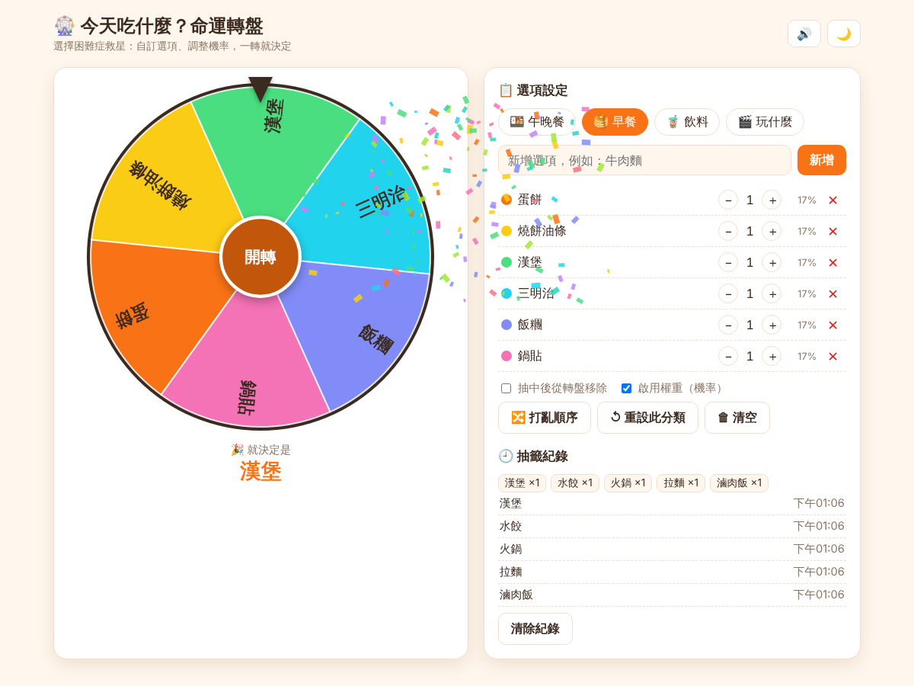
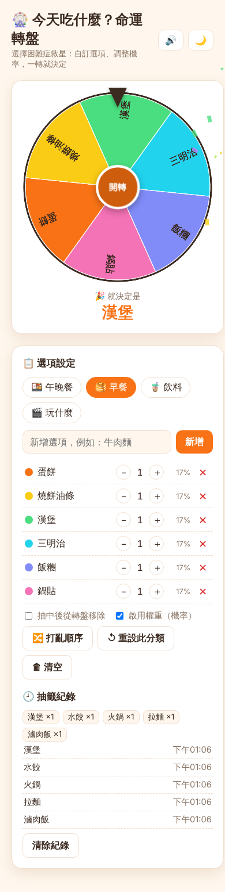

# 🎡 HW 261006｜Vibe Coding 互動網頁 — 今天吃什麼？命運轉盤

## 🔗 網站連結

...

（原始碼：[`index.html`](index.html)，單一檔案，CSS / JavaScript 皆內嵌）

## 📱 介面截圖

| 桌面版 | 手機版（深色模式） |
|:--:|:--:|
|  |  |

---

## 📝 規格書

### 1. 動機與目標
「今天吃什麼？」是日常最常見的選擇困難。希望做出一個**一打開就能用、轉一下就有答案**的小工具，
並且能依自己的口味自訂選項、調整機率。

### 2. 使用者與情境
- 使用者：不知道吃什麼／喝什麼／玩什麼的個人或朋友團體
- 情境：手機或電腦開啟網頁 → 選分類 → 轉轉盤 → 得到結果

### 3. 功能需求
| # | 功能 | 說明 |
|:-:|:--|:--|
| F1 | 轉盤動畫 | Canvas 繪製圓形轉盤，點中間「開轉」後旋轉 4～5 秒，減速停下，指針（頂端）指到的格子即為結果 |
| F2 | 預設分類 | 午晚餐、早餐、飲料、玩什麼，共 4 組範例，一鍵載入 |
| F3 | 自訂選項 | 可新增（上限 20、不可重複、最長 12 字）、刪除、清空、打亂順序、重設分類 |
| F4 | 權重（機率） | 每個選項可設 1～10 權重，格子大小與中獎機率成正比，並即時顯示百分比；可關閉 |
| F5 | 抽中後移除 | 勾選後，抽中的選項會從轉盤移除，適合「輪流決定」 |
| F6 | 抽籤紀錄 | 記錄最近 50 次，顯示最近 8 筆與次數統計 Top 5，可清除 |
| F7 | 音效與特效 | 轉動時指針過格有「喀喀」聲、結果出現時有彩帶與音效，可靜音 |
| F8 | 深色模式 | 一鍵切換，預設跟隨系統 |
| F9 | 資料保存 | 選項、權重、紀錄、設定存在 `localStorage`，重新整理不會消失 |
| F10 | RWD | 手機（≥360px）與桌面皆可使用，小螢幕轉盤與設定面板上下排列 |

### 4. 技術規格
- 單一 `index.html`，無外部套件、無外部資源，可離線使用
- HTML5 + CSS（CSS Variables 做主題、Grid 排版）+ 原生 JavaScript
- Canvas 2D：轉盤與彩帶；Web Audio API：音效
- 中獎演算法：先依權重抽出贏家，再計算停止角度讓指針落在該格內（避開邊線 10%），再以 ease-out 動畫轉到該角度，確保**視覺結果 = 抽籤結果**

### 5. 畫面配置
- 上方：標題、音效／主題開關
- 左側：轉盤 + 結果顯示
- 右側：分類標籤 → 新增輸入列 → 選項清單（顏色點／權重 ± ／百分比／刪除）→ 設定勾選 → 操作按鈕 → 抽籤紀錄

### 6. 與 AI 的迭代過程（Vibe Coding）
1. **v1 想法**：一開始只想要「隨機決定今天吃什麼」。與 AI 討論後擴充為可自訂、可調權重的轉盤。
2. **v2 規格**：整理上方功能表 F1～F10，決定用單一 HTML、不依賴外部套件。
3. **v3 實作**：AI 產出完整 `index.html`；我要求「轉完的結果要跟指針指到的格子一致」，因此改成**先抽結果再反推角度**的作法。
4. **v4 測試**：用 Playwright 自動連轉 4 次，比對結果文字與指針所指格子 → 4/4 一致，且 Console 無錯誤。
5. **v5 優化**：加入深色模式、手機版排版、localStorage 保存、靜音開關、彩帶特效。

### 7. 已知限制與未來可擴充
- 選項上限 20 個（再多文字會太擠）
- 未來可加：分享轉盤連結、匯入／匯出選項、多人同步

---

## 🚀 部署方式（GitHub Pages）
Repo → **Settings → Pages → Build and deployment → Source: Deploy from a branch**，
選擇 `main`（或預設分支）與 `/ (root)`，儲存後約 1 分鐘即可由上方網址開啟。
